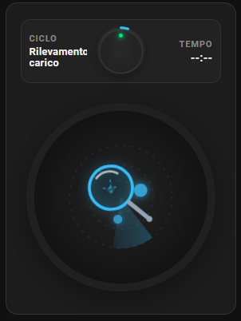
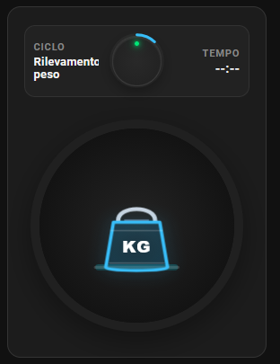
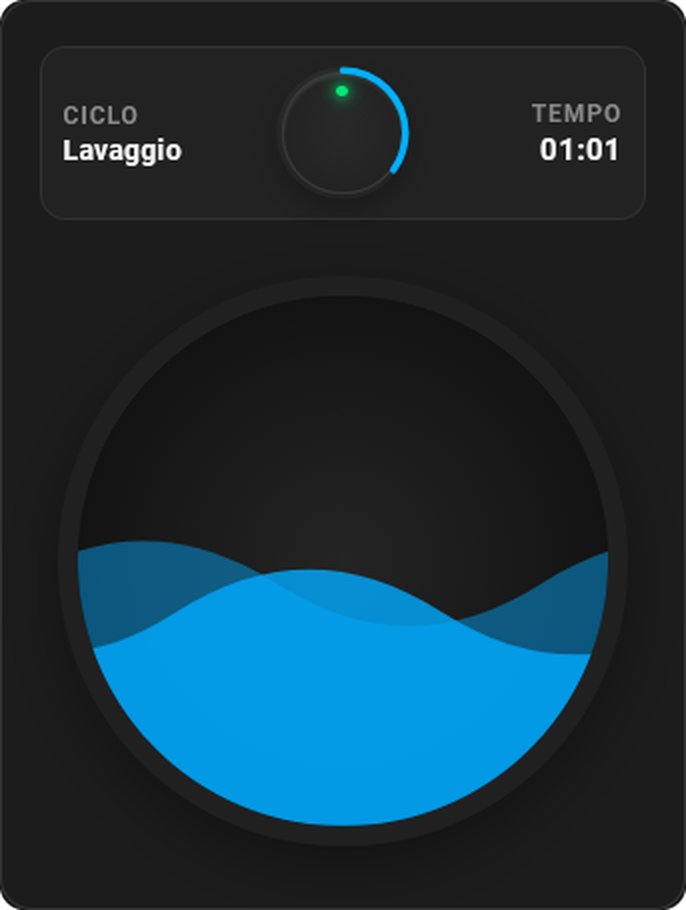
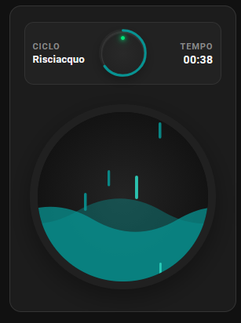
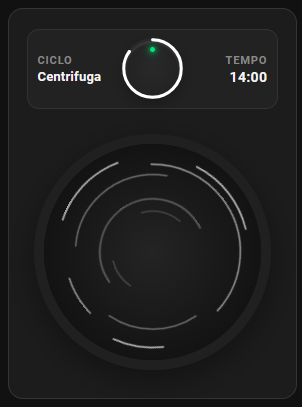
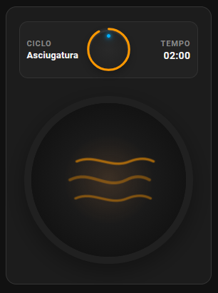
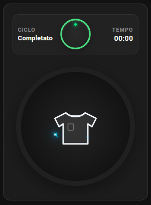
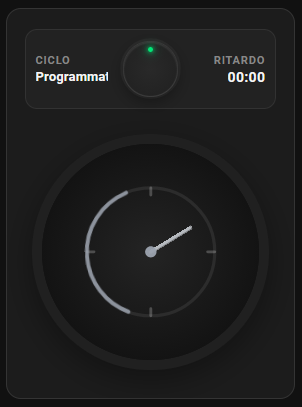
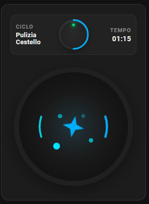

# Minimal Washer Card

[](https://github.com/hacs/default)
[](https://github.com/LuigiPzz/minimal-washer-card/releases)
[](https://opensource.org/licenses/MIT)

Una custom card per **Home Assistant (Lovelace)** dal design ultra-minimale ed elegante ispirato agli elettrodomestici contemporanei di alta gamma.

Include un configuratore visuale (GUI), animazioni realistiche e fluide per tutte le fasi del ciclo (lavaggio, risciacquo, centrifuga, asciugatura, ciclo completato, avvio ritardato), palette monocromatica senza dominanti bluastre e supporto nativo per le Sezioni (Grid View) di Home Assistant.

<div align="center">

### 📸 Tutte le Fasi del Ciclo

| 🔍 Rilevamento Carico | ⚖️ Rilevamento Peso | 🌊 Lavaggio |
| :---: | :---: | :---: |
|  |  |  |

| 🌧️ Risciacquo | 🌪️ Centrifuga | ♨️ Asciugatura |
| :---: | :---: | :---: |
|  |  |  |

| 👕 Completato | 🕒 Programmato | ✨ Pulizia Cestello |
| :---: | :---: | :---: |
|  |  |  |

</div>

---

## ✨ Caratteristiche Principali

- 🎨 **Design Monocromatico Pulito & Neutro**:
  - **Tema Scuro**: Tonalità grafite/antracite profondo e nero puro, privo di riflessi blu-grigiastri.
  - **Tema Chiaro**: Grigio satinato raffinato in alluminio/metallo chiaro (addio al bianco piatto).
  - Passaggio automatico tra tema chiaro e tema scuro basato sulle impostazioni di Home Assistant.
- 📐 **Supporto Nativo Sezioni Lovelace (Grid View)**:
  - Larghezza predefinita a **6 colonne** e altezza calibrata a **5 righe standard** per un allineamento perfetto con card native e Mushroom.
  - Layout adattivo compatto senza margini vuoti in eccesso e con scaling fluido via **Container Queries**.
- 🌊 **Animazioni Dinamiche nell'Oblò (Drum)**:
  - 🌊 **Lavaggio**: Onde d'acqua fluide a doppia frequenza con livello al 52%.
  - 🌧️ **Risciacquo**: Cascata di gocce a pioggia asincrona su 4 colonne e onde turchesi limpide (#079392) sul fondo.
  - 🌪️ **Centrifuga**: Anelli rotanti ultra-sottili ad altissima velocità.
  - ♨️ **Asciugatura**: Alone termico pulsante e linee di calore dinamiche.
  - 👕 **Ciclo Completato**: T-shirt bianca sagomata con 3 stelline blu scintillanti a ciclo continuo.
  - 🕒 **Lavaggio Programmato / Partenza Ritardata**: Quadrante timer orbitante vettoriale monocromatico con indicazione in grande del countdown.
  - ✨ **Pulizia Cestello**: Vortice di sanificazione con scintille e stella splendente.
  - 🔍 **Rilevamento Carico (`laundrysensing`)**: Lente d'ingrandimento fluttuante con mirino di puntamento a croce, fascio radar rotante e rilevamento nodi di carico.
  - ⚖️ **Rilevamento Peso (`weight_sensing`)**: Peso tecnico da calibratura con incisione "KG", molleggio dinamico di pesatura e onde di compressione su pedana.
- ⭕ **Anello di Avanzamento Dinamico & Colorato per Fase**:
  - Corona vettoriale nitida che avanza in senso orario in base alla percentuale del ciclo (`progress_entity`), con colore coordinato alla fase attiva (blu per lavaggio, turchese per risciacquo, bianco per centrifuga, ambra per asciugatura, verde per completato, grigio per programmato, celeste per rilevamenti e pulizia).
- 🇮🇹 **Traduzione Automatica degli Stati del Ciclo**:
  - Converte automaticamente gli stati in lingua inglese dei sensori (es. `idle`, `wash`, `rinse`, `spin`, `dry`, `finish`, `laundrysensing`, `weight_sensing`, `delay`, `drumclean`, ecc.) in descrizioni in italiano chiare e leggibili su display multilinea.
- ⏱️ **Gestione Ore di Ritardo & Conversione `HH:MM`**:
  - Converte automaticamente valori numerici in ore decimali (`1.5` ➔ `01:30`) in ore e minuti formattati.
- 💡 **Manopola Centrale con Micro-LED di Stato a ore 12**:
  - 🔴 **LED Rosso**: Elettrodomestico spento o in standby (`power_entity` = off).
  - 🟢 **LED Verde**: Elettrodomestico acceso in funzionamento standard (`power_entity` = on).
  - 🔵 **LED Blu**: Connessione / Smart Control Wi-Fi attivo (`smart_control_entity` = on).
- 🛠️ **Configuratore Visuale Integrato**:
  - Mappatura completa delle entità tramite editor UI standard (`ha-form`), senza necessità di modificare file YAML.

---

## 📦 Installazione

### HACS (Consigliato)

Minimal Washer Card è disponibile come repository personalizzato in [HACS](https://hacs.xyz/) (Home Assistant Community Store).

[](https://my.home-assistant.io/redirect/hacs_repository/?owner=LuigiPzz&repository=minimal-washer-card&category=plugin)

_oppure_

1. Installa [HACS](https://hacs.xyz/) se non lo hai già
2. Apri HACS in Home Assistant
3. Clicca sui **3 puntini in alto a destra** → **Repository personalizzati**
4. Inserisci l'URL del repository:
   ```
   https://github.com/LuigiPzz/minimal-washer-card
   ```
5. Categoria: **Dashboard** (o *Lovelace*)
6. Clicca **Aggiungi**, cerca **Minimal Washer Card** e premi **Scarica** ⬇️

### Manuale

1. Scarica il file `minimal-washer-card.js` dall'[ultima release](https://github.com/LuigiPzz/minimal-washer-card/releases).
2. Copia il file nella cartella `config/www/` di Home Assistant.
3. Aggiungi la risorsa in uno dei due modi:
   - **Tramite UI:** _Impostazioni_ → _Dashboard_ → _icona 3 puntini_ → _Risorse_ → _Aggiungi risorsa_ → URL: `/local/minimal-washer-card.js` → Tipo: `Modulo JavaScript`.
     > **Nota:** Se non vedi il menu Risorse, abilita la _Modalità avanzata_ nel tuo _Profilo utente_.
   - **Tramite YAML:** Aggiungi il seguente codice alla sezione `lovelace`:
     ```yaml
     resources:
       - url: /local/minimal-washer-card.js
         type: module
     ```

---

## ⚙️ Configurazione

### Configurazione Visuale (GUI)
1. Nella tua dashboard Lovelace, clicca su **Modifica Dashboard** → **Aggiungi Scheda**.
2. Cerca e seleziona **Minimal Washer Card**.
3. Seleziona le entità desiderate dai menu a tendina.

### Esempio YAML Completo

```yaml
type: custom:minimal-washer-card
cycle_entity: sensor.lavatrice_fase_ciclo
time_entity: sensor.lavatrice_tempo_rimanente
progress_entity: sensor.lavatrice_avanzamento_percentuale
power_entity: binary_sensor.lavatrice_alimentazione
smart_control_entity: binary_sensor.lavatrice_smart_control
delay_entity: number.lavatrice_ritardo_di_avvio
```

---

## 📋 Tabella dei Parametri

| Parametro | Tipo | Obbligatorio | Descrizione |
| :--- | :--- | :--- | :--- |
| `cycle_entity` | `entity_id` | **Sì** | Sensore con lo stato o fase corrente del ciclo della lavatrice. |
| `time_entity` | `entity_id` | **Sì** | Sensore del tempo rimanente o durata residua (es. `00:30`, `1h 15m`). |
| `progress_entity` | `entity_id` | No | Sensore numerico percentuale (0-100) per la ghiera di avanzamento attorno alla manopola. |
| `power_entity` | `entity_id` | No | Entità (`binary_sensor`, `switch`, `sensor`) per lo stato di alimentazione (LED verde se acceso, LED rosso se spento/standby). |
| `smart_control_entity` | `entity_id` | No | Entità (`binary_sensor`, `switch`, `sensor`) per lo stato Smart Control / Wi-Fi (LED blu). |
| `delay_entity` | `entity_id` | No | Sensore o `number` con le ore di ritardo (es. `number.lavatrice_ritardo_di_avvio` in formato decimale `x.xxxx` o orario), convertito automaticamente in formato `HH:MM`. |

---

## 🔄 Traduzione Automatica degli Stati del Ciclo

La card traduce e mappa automaticamente i seguenti stati:

| Valore Grezzo del Sensore | Testo Visualizzato sulla Card | Animazione Oblò Attiva |
| :--- | :--- | :--- |
| `idle` / `off` / `standby` | **Off** | *Nessuna* |
| `delaywash` / `delay_wash` / `delay` | **Programmato** | 🕒 Timer Vettoriale Orbitante con Countdown |
| `laundrysensing` | **Rilevamento carico** | 🔍 Lente con Mirino a Croce, Fascio Radar Rotante & Nodi di Carico |
| `weight_sensing` / `weightsensing` | **Rilevamento peso** | ⚖️ Peso Tecnico "KG" Calibrato con Molleggio & Compressione Dinamica |
| `wash` / `washing` | **Lavaggio** | 🌊 Onde d'Acqua Fluide (Livello 52%) |
| `rinse` / `rinsing` | **Risciacquo** | 🌧️ Cascata di Pioggia a 4 Colonne & Onde Turchesi Limpide |
| `spin` / `spinning` | **Centrifuga** | 🌪️ Anelli Rotanti Alta Velocità |
| `drying` / `dry` | **Asciugatura** | ♨️ Alone Termico e Linee di Calore |
| `finish` / `finished` / `complete` / `end` | **Completato** | 👕 T-Shirt Bianca Sagomata & Stelline Blu Scintillanti |
| `drumcleaning` / `drum_cleaning` / `drumclean` | **Pulizia Cestello** | ✨ Vortice Sanificazione & Scintille |

---

## 📄 Licenza

Rilasciato sotto licenza [MIT](LICENSE).
